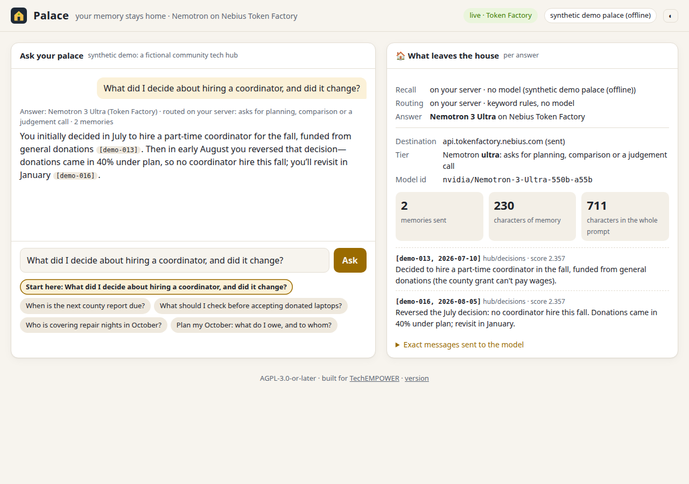

# Palace

**A private personal AI with a real long-term memory: it tells you what you decided, whether it changed, and shows exactly which memories it used. Answers come from NVIDIA Nemotron on Nebius Token Factory.**



## Who it's for

People whose decisions live in long email threads and meeting notes: board members and coordinators of small
volunteer-run organisations. They lose track of what was decided, by whom, and whether it was later reversed.

Palace is built by the founder of **TechEMPOWER**, a small volunteer-run nonprofit in Grass Valley, CA, whose board
decisions live in email threads. The demo uses a synthetic archive for a fictional community tech hub with the
same shape: a grant, a decision made in July and reversed in August, a stale note that still says the old thing.

## The 30-second demo

Open the web chat and press **Start here**: *"What did I decide about hiring a coordinator, and did it change?"*

Palace answers with the current decision and the history behind it. In the live run above, on Nemotron 3 Ultra:
> You initially decided in July to hire a part-time coordinator for the fall, funded from general donations
> [demo-013]. Then in early August you reversed that decision—donations came in 40% under plan, so no coordinator
> hire this fall; you'll revisit in January [demo-016].

Each citation is clickable and highlights the memory it came from. The **"What leaves the house"** panel shows the
two memories that were sent (230 characters of memory, 711 characters in the whole prompt) and the exact messages.

## Which model does what

| Step | Where it runs | Model |
|---|---|---|
| Recall (find the relevant memories) | On your server | None: BM25 over the palace, or a palace-daemon |
| Routing (choose Nano, Super or Ultra, with a stated reason) | On your server | None: keyword rules |
| Answer (grounded only in the recalled memories, with citations) | Nebius Token Factory | **NVIDIA Nemotron 3** Nano (`nvidia/NVIDIA-Nemotron-3-Nano-30B-A3B`), Super (`nvidia/nemotron-3-super-120b-a12b`) or Ultra (`nvidia/Nemotron-3-Ultra-550b-a55b`) |

The web panel shows the same three rows for every answer. Without a key, the Answer row reads "Nemotron not
called (preview)", and the panel shows exactly what *would* be sent.

## Start in 3 steps

1. `python3 -m palace serve`, then open <http://127.0.0.1:8765/>. It runs offline on the synthetic demo palace,
   in preview mode.
2. Press **Start here**, then click a citation like `[demo-016]` to see the memory it came from.
3. Set `NEBIUS_API_KEY` and restart, and the same question is answered live by Nemotron on Token Factory.

> Status: a working build for the Nebius x NVIDIA Global AI Hackathon (Personal AI track). Recall, routing, the
> egress log, the CLI, the web chat and the evals work, and live answers run on Nemotron 3 Nano/Super/Ultra via
> Token Factory (first live eval 2026-10-19; see Evals).

## How it works

```
question ──► recall (palace-daemon: vector + BM25 + graph)  ──► top memories, with ids and dates
         ──► route (Nemotron Nano | Super | Ultra, with a stated reason)
         ──► Token Factory chat, grounded in the numbered memories only
         ──► answer with [citations] + egress record (which snippets left, how many chars)
```

- **Routing.** Nano for quick lookups ("when is…"), Super by default, Ultra only for planning, comparisons and judgement calls ("should I…", "what did I decide, and did it change?") or when many memories must be reconciled.
- **Memory.** [palace-daemon](https://github.com/rboarescu/palace-daemon) (MIT) over HTTP: `GET /search`, `POST /memory`. With no `PALACE_URL`, an offline BM25 index over the synthetic demo palace stands in.
- **Privacy by construction.** The model sees at most 600 characters per memory, only for the memories recalled for that question, and every turn records exactly what was sent.
- **Demo data is synthetic.** `demo/seed.jsonl` is a made-up archive for a fictional person.
- **A guard against real palaces** (`palace/config.py`). `PALACE_URL` is refused if its host is on your deny-list, or if it looks like a home server: a private or link-local IP, a single-label name (`mybox`), a LAN suffix (`.lan`, `.local`, `.home.arpa`, `.internal`), or a public name that resolves to a private address. Loopback is allowed, because that is where a throwaway demo daemon runs. No real hostnames ship in this repo. Put yours, one per line, in `~/.config/palace/forbidden-hosts` or a gitignored `.forbidden-hosts` at the repo root.

## Run

```bash
python3 -m pytest -q                                   # 57 tests, offline
python3 -m palace ask "When is the next county report due?" --dry-run
python3 -m palace eval                                 # offline: recall@k + router tier accuracy
NEBIUS_API_KEY=... python3 -m palace models            # check the tier ids against the live catalog
NEBIUS_API_KEY=... python3 -m palace ask "Should I still plan on hiring a coordinator?"
NEBIUS_API_KEY=... python3 -m palace eval --live       # also: citation validity, abstention, tokens, cost
python3 -m palace serve                                # web chat on http://127.0.0.1:8765/
```

**Web chat.** `palace serve` opens a chat page with a **"What leaves the house"** panel: for every answer it shows the Nemotron tier and why it was chosen, the memories recalled (with ids and dates), how many characters of memory left, and the exact messages sent to Token Factory. Citations in an answer are clickable and highlight the memory they came from. Without `NEBIUS_API_KEY` the page runs in **preview** mode: recall and routing run, and the panel shows what *would* be sent, but nothing is. Light and dark themes; no JavaScript dependencies; binds to `127.0.0.1` unless you pass `--host`.

| Env | Meaning |
|---|---|
| `NEBIUS_API_KEY` | Token Factory API key |
| `NEBIUS_BASE_URL` | OpenAI-compatible base URL (default `https://api.tokenfactory.nebius.com/v1/`, verified live) |
| `PALACE_MODEL_NANO/SUPER/ULTRA` | Model ids per tier (defaults verified in the live catalog 2026-10-19; `palace models` re-checks) |
| `PALACE_PRICE_NANO/SUPER/ULTRA` | `"input,output"` USD per 1M tokens, for the per-answer cost (defaults in `config.py`) |
| `PALACE_URL`, `PALACE_API_KEY` | A **demo** palace-daemon; omit to use the offline synthetic palace |
| `PALACE_FORBIDDEN_HOSTS` | Comma-separated hosts that serve a **real** palace (added to the files below); subdomains are covered too |
| `PALACE_FORBIDDEN_HOSTS_FILE` | One more deny-list file (default files: `~/.config/palace/forbidden-hosts`, `./.forbidden-hosts`) |
| `PALACE_ALLOW_HOSTS` | Opts a LAN-looking **demo** daemon back in. It never overrides the deny-list |
| `PALACE_MAX_ASKS_PER_HOUR` | `palace serve`: caps **live** model calls across all visitors (a public demo shouldn't drain your credits). Over the cap, the page falls back to a preview. Unset means no cap |

**Container.** `docker build -t palace-nemotron .` then `docker run --rm -p 8080:8080 -e NEBIUS_API_KEY -e PALACE_MAX_ASKS_PER_HOUR=120 palace-nemotron`. The image serves the web chat on the synthetic demo palace, as a non-root user.

## Evals

`evals/questions.jsonl` holds 26 questions over the synthetic palace, each with the memories a good answer must
cite and the tier it deserves; two have no answer in the palace and should be declined. `palace eval` writes a
report to `evals/runs/`. Offline it scores **recall@k** (are the expected memories in the prompt?) and **tier
accuracy**; `--live` adds **citation validity** (does the answer cite only memories it was given?),
**expected-citation hits**, **abstention** on unanswerable questions, and token, latency and cost totals.

| Run (2026-10-19) | recall@k | tier acc. | citation valid | expected cited | abstain | tokens | cost | time |
|---|---|---|---|---|---|---|---|---|
| `baseline-offline` | 0.958 | 0.731 | | | | | | |
| `live-2026-10-19` (before the fix) | 0.958 | 0.731 | 1.0* | 0.792 | 1.0 | 10,368 + 4,249 | $0.0097 | 40 s |
| `live-2026-10-19-normalised` | 0.958 | 0.731 | 1.0 | 0.958 | 1.0 | 10,368 + 4,382 | $0.0102 | 41 s |

\*Not real evidence. Nemotron 3 Super cited 4 answers as `【demo-008】`, so the scorer saw *no* citations
on them, and "no invented ids" was vacuous. Answers are now normalised to `[demo-008]` and the scorer
reads both forms. Re-scoring the saved answers gives 23/24, and still no invented ids. The remaining miss
(q13) is recall: no stemming, so "hotspots/returned" doesn't match "Hotspot/returns". The tier misses are
the keyword router's (see the "miss" lines from `palace eval`).

## Limitations

These are real failure cases from the 26-question live eval (`evals/runs/live-2026-10-19-normalised.json`), not
hypotheticals.

- **The router picks the wrong tier about a quarter of the time** (tier accuracy 0.731, 7 of 26), in both
  directions:
  - **Too small.** q06, "Which grant did we apply for, and why not the state one?", went to Nano, but a "why" over two
    memories deserves Super.
  - **Too big.** q09 ("How should I format printed guides for the seniors class?") and q10 ("Why did the grant
    portal reject our budget PDF?") went to Ultra. Ultra averaged **$0.00117 per answer, against $0.00021 for
    Super**, so that's about 5–6× the cost for no gain.
  - **Bigger than needed.** q12, q14, q25 and q26 went to Super where Nano would do (Nano averaged $0.00007).
  - The router is keyword rules; `palace eval` prints every miss.
- **Recall has no stemming.** q13, "How do we get borrowed hotspots returned on time?", missed the memory that says
  "Hotspot returns", so the answer couldn't cite it (recall@k 0.958, expected-cited 0.958).
- **Citation format varies by model.** Nemotron 3 Super cited as `【demo-008】` instead of `[demo-008]`. Palace now
  normalises both forms, but before the fix the scorer saw no citations on 4 answers and "no invented ids" was
  vacuous (see Evals).
- **Stale notes are only as good as the archive.** Palace answers from what's in the palace. If a reversal was never
  written down, it will confidently report the old decision. It never invents one: both unanswerable eval questions
  were declined (abstain 1.0).
- **Latency and cost** on the live eval: Nano 1.3 s mean, Super 1.7 s mean (max 4.0 s), Ultra 1.7 s mean (max 2.9 s).
  The whole 26-question run cost $0.0102. A public demo should set `PALACE_MAX_ASKS_PER_HOUR`.
- **The real-palace guard is a heuristic** (`palace/config.py`). It refuses hosts that look like a home server,
  which can also refuse a legitimate demo daemon on a LAN until `PALACE_ALLOW_HOSTS` opts it in.

## Accessibility

What the web chat does today, checked in a headless browser on 2026-10-21. It hasn't yet been tested with a screen
reader.
- **Keyboard only:** every control is a native button or input. Tab runs theme → question → Ask → Start here → the
  other examples, and the browser's focus ring is kept.
- **Labelled regions and announced answers:** the chat, the question box and the panel have labels, and new answers
  arrive in a polite live region.
- **Light and dark themes** follow the system setting, with a toggle. The text pairs checked meet WCAG AA contrast:
  starter 14.1:1 light and 11.7:1 dark; muted text 5.3:1 and 7.1:1.
- **Reduced motion:** smooth scrolling is turned off when the system asks for reduced motion. Nothing else animates.
- **No JavaScript dependencies**, and the page is a single static file.

## Roadmap to submission (Oct 30, 2026)
1. ~~Confirm the Nemotron 3 Nano/Super/Ultra ids with `palace models`; make the first real call and a live eval run.~~ (done 2026-10-19)
2. Hermes Agent persona: expose `recall`, `remember` and `brief_me` as Hermes tools that call this turn loop.
3. Optional: re-embed the demo wing with an NVIDIA embedding model on Token Factory; compare latency and quality.
4. ~~Web chat with the "what leaves the house" panel (dark/light)~~ (done: `palace serve`); public demo on the synthetic palace.
5. Optional Tavily web-search tool.
6. Demo video (≤3 min) naming Token Factory and Nemotron; README feedback section.

## License

AGPL-3.0-or-later © 2026 Jeffrey Pine Hein. See [LICENSE](LICENSE). Built for [TechEMPOWER](https://techempower.org).

Source: <https://github.com/jphein/palace> (a running server links it at `/version`). This repository's history starts
from a squashed snapshot on 2026-09-27; development before that happened in a private repository, which is not published.
